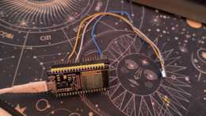

# ESP32 receive-only IR learner

This is the hardware side of the Universal Remote learning workflow. It is intentionally **receive-only**: the ESP32 captures infrared signals while the Android phone remains the device that can later replay a valid capture through its own IR blaster.

## Prototype hardware



The photographed prototype is the actual development rig: an ESP32 development board connected to a demodulating IR receiver. The exact receiver part number is not asserted from appearance alone.

Current verified setup status:

- ESP32 identified as **ESP32-D0WD-V3 (revision v3.1), 4 MB flash**.
- Receive input uses **GPIO 27** on this classic ESP32 build.
- Receive-only firmware compiled and uploaded successfully.
- Serial heartbeat passed.
- Hardware receive path was physically tested.
- **Five test IR frames were captured**.
- The original Philips SPA5250B/94 remote is not currently available, so no Philips commands are marked as verified.

## What the firmware captures

`ir_learner.ino` uses IRremoteESP8266 and begins listening after boot. For each frame it preserves as much evidence as possible:

- decoded protocol name and ID;
- bit count;
- address, command and decoded value when the protocol is known;
- state bytes for stateful protocols;
- repeat and overflow flags;
- raw mark/space timing envelope in microseconds;
- sequence number, uptime and queue-loss information.

Unknown signals are deliberately retained instead of discarded. Their decoder hash is metadata only and is **not** treated as a transmittable command.

The firmware uses a 2048-entry receive buffer, a six-frame output queue, a 20 ms frame timeout and 115200-baud JSON serial output. There is no IR emitter, Wi-Fi, Bluetooth, OTA or network service in this firmware.

## Host tools

The companion scripts are under [`tools/ir_capture/`](../../tools/ir_capture/):

- `setup.py` — prepares the pinned workspace-local Arduino/ESP32 toolchain.
- `device.py` — identifies the board, builds the firmware, backs up the original flash and uploads the receive-only build.
- `record.py` — records serial bytes and parsed captures into structured local sessions without deduplicating repeats/unknowns.
- `compare.py` — compares labeled captures from different sessions without automatically promoting a match into a verified app profile.

A typical computer-side recording session is:

```sh
.tools/esp32/python/bin/python tools/ir_capture/record.py listen --port auto --source phone_app
```

The recorder stores sessions under `captures/ir/` with the raw serial stream, parsed JSONL captures, events, context and status. Captures and original-flash backups are intentionally excluded from Git.

## Learning workflow

1. Power the ESP32 and connect the receiver.
2. Start a capture session on a computer or, in the development workflow, through Android USB OTG.
3. Aim the original remote at the receiver and press one button several times.
4. Label the function, such as `POWER`, `VOLUME_UP` or `INPUT`.
5. Repeat for the remaining buttons.
6. Compare repeated captures and preserve raw timings when decoding is uncertain.
7. Only after validation should a command be promoted into the Android remote database.

Phone-app test captures and original-remote captures are kept as different evidence sources. Capturing what another app transmits does not prove that the original appliance remote uses that signal.

## Carrier-frequency limitation

A demodulating receiver such as the TSOP family removes the high-frequency IR carrier before the ESP32 sees the data. Therefore this setup can capture the command envelope but **cannot directly measure the original carrier frequency**. A nominal 38 kHz receiver passband is not proof that the transmitter used exactly 38 kHz.

Carrier information should come from a known protocol/manufacturer source or suitable measuring hardware. The Android replay workflow may use a documented or explicitly trial carrier value, but it must not be presented as measured by this receiver.

## Android integration

The development app workflow is documented in [`docs/USB_LEARNING.md`](../../docs/USB_LEARNING.md). A capture can be transferred over USB OTG, named and stored locally, exported for inspection, and replayed through a phone with real consumer-IR hardware when the frame is complete and safe to replay.

The ESP32 itself remains receive-only.
